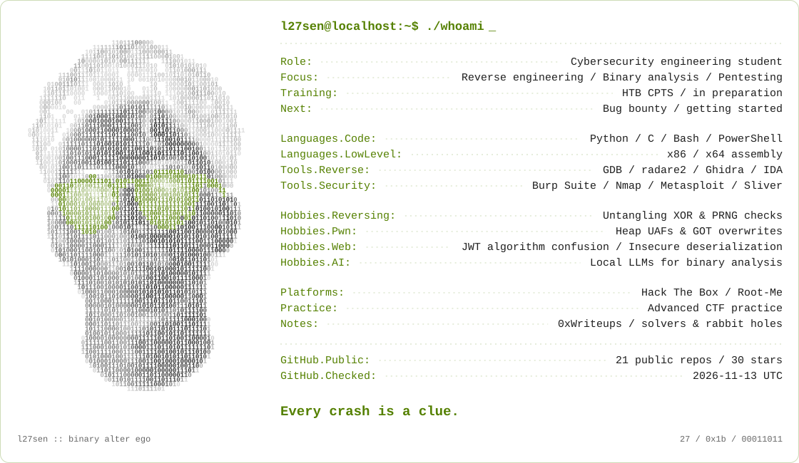

<!-- Generated artwork: python scripts/render_profile.py -->
<picture>
  <source media="(prefers-color-scheme: dark) and (max-width: 600px)" srcset="./assets/profile-dark-mobile.svg">
  <source media="(max-width: 600px)" srcset="./assets/profile-light-mobile.svg">
  <source media="(prefers-color-scheme: dark)" srcset="./assets/profile-dark.svg">
  
</picture>

  <a href="https://app.hackthebox.com/public/users/2961025">Hack The Box ↗</a>
  &nbsp; · &nbsp;
  <a href="https://www.root-me.org/larsen-893035">Root-Me ↗</a>
  &nbsp; · &nbsp;
  <a href="https://github.com/LahsenAitOiahmane/0xWriteups">0xWriteups ↗</a>

Behind the bits / text version

Hey, I'm **Lahsen**, aka **`l27sen`**. Cybersecurity engineering student, reverse-engineering rabbit-hole regular, and advanced CTF practitioner on Hack The Box and Root-Me.

I like understanding what the binary actually does, writing a solver to prove it, and leaving a useful writeup behind. My idea of a hobby:

- **Reversing:** untangling XOR loops, PRNG checks, and the occasional decoy flag.
- **Pwn:** exploring heap use-after-free bugs and GOT overwrites in CTFs.
- **Web:** picking apart JWT algorithm confusion and authentication logic in labs.
- **AI:** building local LLM and RAG tools that help explain binary analysis.

**Languages:** Python, C, Bash, PowerShell; reading x86/x64 assembly. 
**Tools:** GDB, radare2, Ghidra, Burp Suite, Nmap, CodeQL, Semgrep.

**[Hack The Box](https://app.hackthebox.com/public/users/2961025)** and **[Root-Me](https://www.root-me.org/larsen-893035)** are where I practice. Follow the links for current progress. My notes live in **[0xWriteups](https://github.com/LahsenAitOiahmane/0xWriteups)**.

*Every crash is a clue.*

<!-- Maintenance and workflow details: docs/PROFILE.md -->
